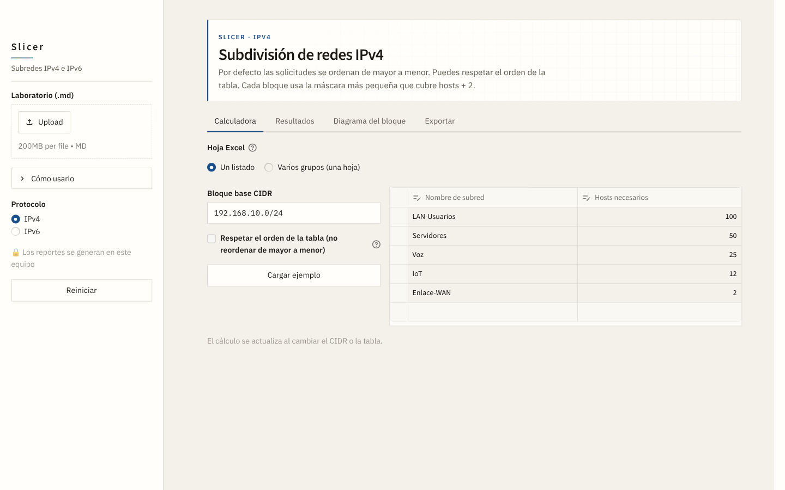
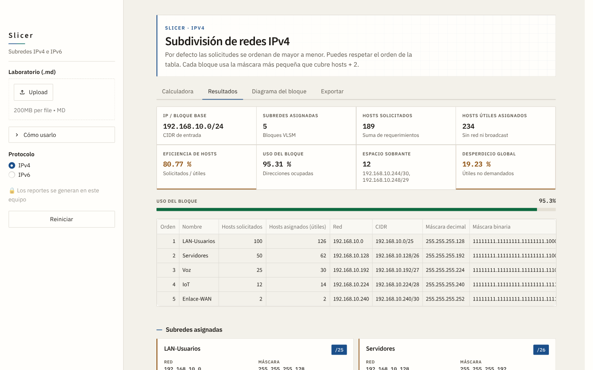
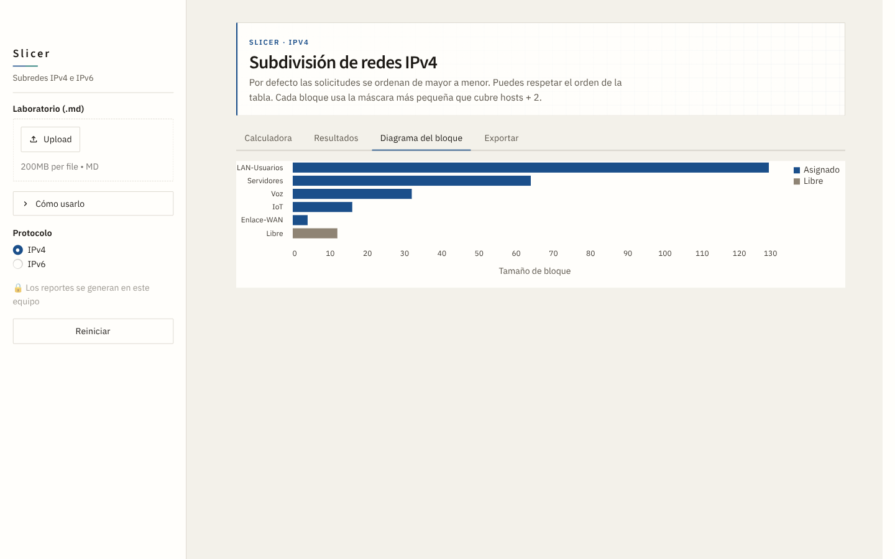

# Slicer

Slicer arma el plan de direccionamiento de un laboratorio: el bloque, las subredes, la máscara, el rango útil y lo que sobra. Trabaja con VLSM en IPv4 y con prefijos en IPv6.

Escribes los hosts que necesita cada red. Slicer asigna el bloque, muestra el resultado y lo deja listo para descargar.



## El resultado

La pestaña **Resultados** resume el bloque y lista cada subred con su red, su CIDR y su máscara.



El color de las métricas distingue el estado del plan. Verde cuando el aprovechamiento es alto, ámbar cuando queda a medias y rojo cuando se desperdicia demasiado espacio.

Cada subred IPv4 pide hosts útiles. El bloque que recibe es la potencia de 2 que cubre esos hosts más la dirección de red y la de broadcast. Por defecto entra primero la subred más grande. Si el enunciado trae un orden fijo, se marca «Respetar el orden de la tabla».

## El bloque, de un vistazo

**Diagrama del bloque** muestra cuánto ocupa cada subred y cuánto queda libre.



## Cuatro pestañas

| Pestaña | Qué tiene |
| --- | --- |
| Calculadora | El bloque base y la tabla de subredes |
| Resultados | Métricas, direcciones y memoria del cálculo |
| Diagrama del bloque | El reparto del espacio |
| Exportar | Excel, CSV, JSON y Markdown |

En IPv4 hay dos formas de trabajar. **Un listado** es una sola tabla sobre un bloque. **Varios grupos** apila edificios o sedes en la misma hoja. El botón **Cargar laboratorio Tendencias** abre el ejemplo de `examples/tendencias.md`: `172.16.128.0/21`, un `/23` por edificio.

En IPv6 se puede partir un prefijo fijo, por ejemplo un `/48` en redes `/64`, o calcular el prefijo según la cantidad de dispositivos.

## Un laboratorio en un archivo

La barra lateral acepta un Markdown con el enunciado completo. En la terminal, el mismo archivo entra con `--from-md`.

```markdown
# Laboratorio

- Protocolo: IPv4
- Base: 172.16.128.0/21
- Modo: grupos
- Prefijo grupo: 23
- Orden: tabla

## Edificio 1

| Nombre | Hosts |
| --- | --- |
| Area de RRHH | 66 |
| Ventas | 38 |
```

`listado` e IPv6 usan una sola sección `## Subredes`. En grupos, cada `##` es un edificio. El ejemplo entero está en `examples/tendencias.md`.

## Arranque

```bash
./setup.sh
```

Abre Slicer en http://127.0.0.1:8501.

Por terminal:

```bash
.venv/bin/python cli.py ipv4 192.168.10.0/24 -s LAN:100 -s WAN:2 --excel plan.xlsx
.venv/bin/python cli.py ipv4 --from-md examples/tendencias.md --excel tendencias.xlsx
.venv/bin/python cli.py ipv6 2001:db8:abcd::/48 --prefix 64 --count 4
```

## Excel

El libro IPv4 deja la tabla de subredes a la izquierda y, en las mismas filas, el cálculo bit a bit. Arriba está la tabla de potencias de 2. La hoja de varios edificios se llama «VLSM Por EDIFICIO».
